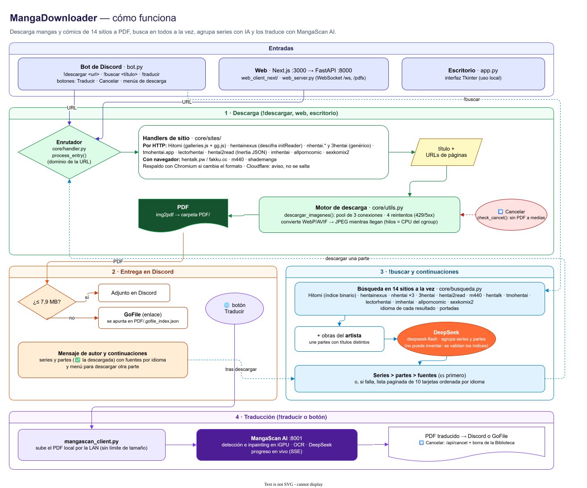

# MangaDownloader

Descarga mangas, doujinshi y cómics de **14 sitios** a PDF, **busca en todos a la vez**, agrupa las partes de una
serie con IA (DeepSeek) y, con un botón, **los traduce** con [MangaScan AI](https://github.com/Holkeano526/mangascan).

Se usa sobre todo como **bot de Discord** (corre en un NAS con Docker), pero el mismo núcleo (`core/`) sirve
también a una interfaz web (Next.js + FastAPI) y a una app de escritorio (Tkinter).

## Repos hermanos

MangaDownloader y MangaScan AI son **dos repos hermanos**: se desarrollan y despliegan por separado, pero forman una sola herramienta. Este repo **consigue** el manga y MangaScan lo **traduce**.

| Repo | Qué hace | En el NAS |
|---|---|---|
| [**MangaDownloader**](https://github.com/Holkeano526/MangaDownloader) | Descarga a PDF desde 14 sitios, `!buscar` en todos a la vez, agrupación de series con DeepSeek. Bot de Discord, web y escritorio | `manga_discord_bot` (receta OMV `manga-downloader`) |
| [**MangaScan AI**](https://github.com/Holkeano526/mangascan) | Traduce el PDF al español latino: detección y borrado en la iGPU, OCR y DeepSeek | `mangascan-ai`, puerto `8001` |

**Contrato entre los dos** (`mangascan_client.py` en MangaDownloader ↔ API de MangaScan):

| Endpoint de MangaScan | Para qué lo usa el bot |
|---|---|
| `GET /api/jobs` | Ver si MangaScan responde y si tiene trabajos en cola |
| `POST /api/upload` | Subir el PDF (por la LAN, sin el límite de tamaño de Discord) |
| `GET /api/stream/{task_id}` | Progreso en vivo (SSE) para el embed de Discord |
| `GET /api/download/{task_id}` | Descargar el PDF traducido |
| `POST /api/cancel/{task_id}` y `DELETE /api/jobs/{task_id}` | Botón ⏹️ Cancelar: parar el trabajo y borrarlo de la Biblioteca |

- **Cambiar uno de estos endpoints** (ruta, campos o formato del SSE) obliga a actualizar el otro repo en el mismo ciclo: un PR en cada uno, y desplegar primero MangaScan.
- **Configuración compartida:** el bot apunta a MangaScan con `MANGASCAN_URL` y usa la **misma clave de DeepSeek** (`DEEPSEEK_API_KEY`, modelo `deepseek-flash`) para agrupar series.
- **Independientes:** cada uno funciona solo. Si MangaScan está apagado, el bot descarga igual y el botón 🌐 Traducir avisa de que MangaScan no responde. MangaScan tiene su propia interfaz web para subir PDFs a mano.
- **Mismas convenciones:** documentación en español, diagrama de flujo en `docs/flujo_app.drawio(.svg)`, rama + PR por cambio e imagen base congelada para desplegar en el NAS.

## Cómo funciona

<p align="center">
  
</p>

> El diagrama es un `.drawio.svg`: se ve en GitHub y se edita abriéndolo con draw.io
> (fuente: [`docs/flujo_app.drawio`](docs/flujo_app.drawio)).

1. **Descarga.** `core/handler.py` elige el primer handler cuyo dominio aparece en el *hostname* de la URL
   (no en cualquier parte de la URL, para evitar SSRF). El handler obtiene el título y la lista de páginas,
   casi siempre por HTTP puro; Chromium (Playwright) queda para los sitios que lo necesitan o como respaldo.
   `core/utils.descargar_imagenes()` baja las páginas en paralelo con reintentos y convierte WebP/AVIF a JPEG
   mientras llegan; luego `img2pdf` arma el PDF.
2. **Entrega.** Si el PDF pesa ≤ 7,9 MB se adjunta en Discord; si no, se sube a **GoFile** y se apunta en
   `PDF/.gofile_index.json`. Junto al PDF aparece el botón **🌐 Traducir**.
3. **Autor, continuaciones y versión sin censura (a petición).** Tras cada descarga el bot muestra el autor
   y tres botones: **🔎 Buscar continuación** (las otras partes de la serie en todos los sitios, agrupadas en
   series › partes › fuentes por idioma, con un menú para descargarlas), **🔓 Versión sin censura** y
   **✍️ Más obras de &lt;autor&gt;**. No busca nada hasta que pulsas uno.
4. **Traducción.** El bot sube el PDF local a MangaScan por la LAN (sin el límite de Discord), sigue el
   progreso y devuelve el PDF traducido por Discord o GoFile.

## Bot de Discord

| Comando | Qué hace |
|---|---|
| `!descargar <url>` | Descarga a PDF. Acepta una ficha, un lector o una serie (pone sus capítulos en cola). Con un código numérico (`!descargar 177013`) **no descarga directo**: muestra las mismas opciones que `!buscar 177013` para que elijas el sitio. |
| `!buscar <título>` | Busca ese título en los 14 sitios y agrupa con DeepSeek en series › partes › fuentes (🇪🇸 primero, luego 🇬🇧). Si la IA falla, muestra una lista paginada de tarjetas con portada. Funciona sin número de parte: `!buscar The Wife-Lenders`. **No** suma las demás obras del autor: eso se pide con *Más obras del autor*. |
| `!buscar <código>` | Código numérico de nhentai / Hitomi ("nuclear code"): `!buscar 177013` o `!buscar #177013`. Ver [Búsqueda por código](#búsqueda-por-código). |
| `!buscar <título> uncensored` | Solo las versiones **sin censura** de esa obra (también vale `decensored` o `sin censura`). Ver [Versión sin censura](#versión-sin-censura). |
| `!traducir <enlace GoFile \| nombre.pdf>` | Traduce con MangaScan un PDF que el bot ya descargó (por su enlace de GoFile o su nombre). También acepta un PDF adjunto al mensaje. |
| `!help` | Ayuda. |

**Botones:** ⏹️ Cancelar (descarga y traducción; no deja PDFs a medias), 🌐 Traducir (en cada PDF entregado),
🔎 *Buscar continuación*, 🔓 *Versión sin censura* y ✍️ *Más obras de &lt;autor&gt;* (tras cada descarga); menú
*Descargar una parte*, ✍️ *Más obras de &lt;artista&gt;*, 🔓 *Versión sin censura* y 📋 *Ver todos los resultados*
en las series. En la lista de tarjetas (también la de `!buscar <código>`): menús *Elige uno para descargarlo*,
*🔎 Buscar continuación de…*, *✍️ Más obras del autor de…* y *🔓 Buscar versión sin censura de…*. Las tarjetas
sin censura llevan la marca 🔓.

### Búsqueda por código

Si el texto es solo un número (`177013`, `#177013`), el bot lo toma como el código de una galería y lo busca
a la vez en:

- **nhentai**, a través de **nhentai.to**: nhentai.net es una app JavaScript tras Cloudflare (no se usa) y,
  de sus mirrors, nhentai.to es el único que conserva la numeración original (177013 = *METAMORPHOSIS*).
  nhentai.xxx, nhentai.website y 3hentai numeran a su manera, así que no sirven para códigos.
- **Hitomi**, con el mismo `galleries/<id>.js` que usa la descarga.

**El mismo número es una obra distinta en cada sitio** (177013 en Hitomi es *Cranky Girl*), así que no se
mezclan: sale una tarjeta por sitio con título, portada, idioma, sitio, nº de páginas y artista, y el menú
para descargar la que quieras. Si el código solo existe en un sitio, sale solo esa; si no existe en ninguno,
el bot lo dice. Por esa ambigüedad, `!descargar <código>` enseña las opciones en vez de descargar directo.

Para buscar una obra cuyo título es un número, añade alguna palabra (`!buscar 1000 nights`).

### Versión sin censura

Muchas obras tienen una versión *uncensored* / *decensored* / *sin censura*. Se pide con
`!buscar <título> uncensored`, con el botón **🔓 Versión sin censura** (tras una descarga o en las series) o
con el menú **🔓 Buscar versión sin censura de…** de la lista de tarjetas.

Buscar la palabra «uncensored» a secas devuelve cualquier obra sin censura, así que el bot busca **el título
de la obra** (sin etiquetas como `[English]` ni el título alternativo) en los 14 sitios, solo y con
«uncensored», y se queda con los resultados que:

- lo marcan en el título: `(Uncensored)`, `[Decensored]`, `(Sin Censura)`, `(DC)`, `無修正`… En Hitomi también
  vale su etiqueta `uncensored` (el bot añade «(Uncensored)» al título), y en lectorhentai su etiqueta
  «Sin Censura» de la tarjeta;
- se parecen al título buscado (≥ 0,8), así que la parte 3 no trae la 2 sin censura.

Si no hay ninguna, el bot lo dice. Depende del buscador de cada sitio: si un sitio no encuentra la obra
por su título, tampoco encontrará su versión sin censura.

## Sitios compatibles

| Sitio | Descarga | Búsqueda | Cómo |
|---|:-:|:-:|---|
| hitomi.la | ✅ | ✅ | HTTP: `galleries.js` + `gg.js`; búsqueda en su índice binario (B-tree + `.nozomi`) y por código |
| hentainexus.com | ✅ | ✅ | HTTP: descifra la lista de páginas de `initReader` (respaldo con navegador) |
| nhentai.to · .xxx · .website | ✅ | ✅ | HTTP, handler genérico para los clones de nhentai. Los códigos de nhentai se buscan en nhentai.to (única con la numeración original) |
| 3hentai.net | ✅ | ✅ | HTTP (mismo handler genérico; verifica el nº real de páginas) |
| tmohentai.app | ✅ | ✅ | HTTP |
| lectorhentai.com | ✅ | ✅ | HTTP |
| hentai2read.com | ✅ | ✅ | HTTP: JSON de Inertia |
| m440.in | ✅ | ✅ | Navegador (crawl4ai / Playwright) |
| hentalk.pw (y enlaces fakku.cc) | ✅ | ✅ | Navegador |
| imhentai.xxx | ✅ | ✅ | HTTP: servidor, carpeta y extensión de cada página en la ficha (`load_*`, `g_th`) |
| allporncomic.com | ✅ | ✅ | HTTP (WordPress Madara). Un cómic o un artista ponen sus capítulos en cola |
| sexkomix2.com | ✅ | ✅ | HTTP; busca en español e inglés. Un estudio o una categoría ponen sus cómics en cola |
| shademanga | ✅ | — | Navegador |
| nhentai.net · nhentai.top | ⚠️ | — | Protegidos por Cloudflare: el bot avisa y sugiere un espejo. **No se intenta saltar la protección.** |
| chochox.com · vercomicsporno.com | 🔁 | — | Desafío de Cloudflare en todas sus páginas: no se les pide nada. `!descargar` con un enlace suyo saca el título (y el artista) del propio enlace y ofrece **la misma obra en los sitios compatibles**. |

## Configuración

Variables de entorno (en Docker van en el `.env` del servicio):

| Variable | Por defecto | Uso |
|---|---|---|
| `DISCORD_TOKEN` | — | Token del bot (obligatorio). |
| `DEEPSEEK_API_KEY` | — | Agrupación de series con IA. Sin clave, `!buscar` muestra la lista normal. |
| `DEEPSEEK_MODEL` | `deepseek-flash` | Modelo de DeepSeek. |
| `DEEPSEEK_API_URL` | `https://api.deepseek.com/chat/completions` | Endpoint compatible con OpenAI. |
| `MANGASCAN_URL` | IP del NAS, puerto `8001` | URL de MangaScan AI en la LAN (repo hermano, ver arriba). |
| `CONCURRENCIA_IMAGENES` | `3` | Conexiones simultáneas por descarga. |
| `JPEG_CALIDAD` | `70` | Calidad al convertir WebP/AVIF a JPEG. |
| `HEADLESS` | `true` | Navegador sin ventana (Docker). |

## Instalación

### Docker (NAS)

El bot corre como servicio `discord_bot`. La imagen parte de una base congelada
(`manga-downloader-discord_bot:base-20260816`) porque `requirements.txt` no fija versiones y un build desde
cero puede romperse; los cambios de código se añaden como una capa fina con `Dockerfile.bot`:

```bash
docker build -f Dockerfile.bot -t manga-downloader-discord_bot:latest .
docker compose up -d --no-build --force-recreate discord_bot
```

Antes de reiniciar el bot, comprobar que no haya una descarga ni una traducción en curso.

### Local

```bash
pip install -r requirements.txt
playwright install chromium
python bot.py          # bot de Discord (requiere .env con DISCORD_TOKEN)
python app.py          # escritorio
START_WEB_VERSION.bat  # web: FastAPI :8000 + Next.js :3000 (Windows)
```

## Estructura

```
bot.py               Bot de Discord: comandos, vistas (botones/menús), entrega y traducción
mangascan_client.py  Cliente HTTP de MangaScan AI (subida, progreso, cancelar)
app.py               App de escritorio (Tkinter)
web_server.py        API FastAPI + WebSocket para web_client_next/
core/
  handler.py         Enrutador URL → handler (el orden importa)
  utils.py           Motor de descarga, conversión de imágenes y PDF
  busqueda.py        Búsqueda en todos los sitios, idioma, autor, continuaciones
  agrupador.py       Agrupación en series/partes con DeepSeek
  config.py          Constantes (User-Agent, carpetas)
  sites/             Un handler por sitio (BaseSiteHandler)
docs/                Diagrama de flujo (draw.io)
```

## Rendimiento

Medido en el NAS (contenedor limitado a 1–2 CPU):

| Prueba | Resultado |
|---|---|
| nhentai.to, 80 páginas | 11,5 s, 0 errores |
| hentainexus, 41 páginas | 4,8 s |

Claves: lista de páginas por HTTP en vez de navegador, pool paralelo con reintentos ante 429/5xx, conversión de
imágenes mientras se descarga (hilos = CPU que permite el cgroup, para evitar *throttling*).

## Añadir un sitio

Ver [HOW_TO_ADD_SITES.md](HOW_TO_ADD_SITES.md).

## Límites

- Los sitios con Cloudflare/anti-bot (nhentai.net, nhentai.top, chochox.com, vercomicsporno.com) no se
  descargan: se avisa al usuario.
- Tras una descarga solo se ofrecen las partes posteriores: si bajaste el recopilatorio "1-3", el menú
  empieza en la 4.
- Los sitios cambian su HTML; si un handler HTTP deja de funcionar, los que tienen respaldo pasan al navegador
  y el resto da un error claro en el log.
- La agrupación con IA depende de DeepSeek; en horas punta (UTC 01–04 y 06–10, lun–vie) el precio es ×2.
